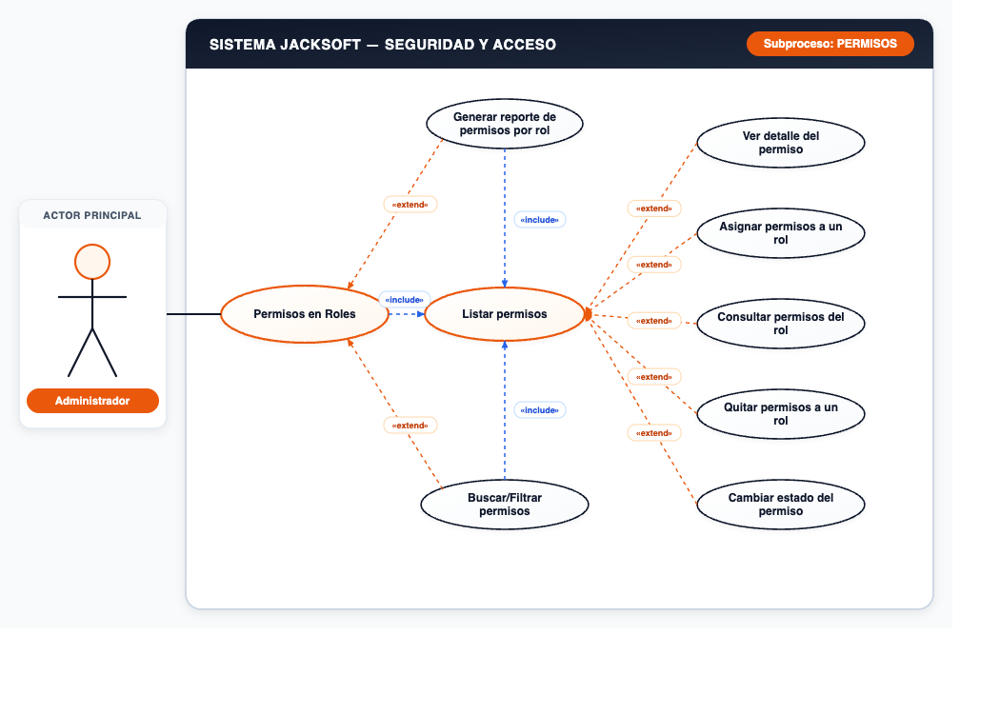
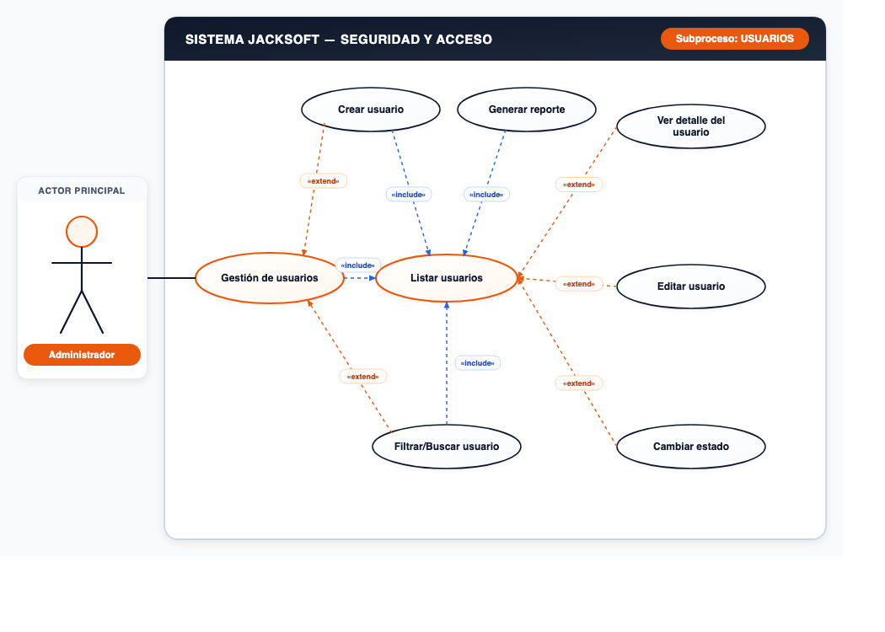
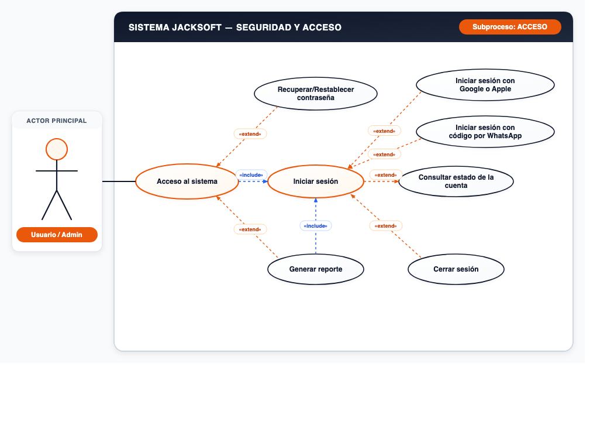

# 📌 CU-01: Módulo de Configuración y Seguridad

## 📌 Descripción General
Gestión de permisos (matriz módulo × acción por rol), roles, usuarios, mecanismos de autenticación y acceso al sistema, y configuraciones generales (valores del negocio y funcionalidades activables).

---

## 📋 Subprocesos y Especificación Funcional

### Subproceso 1: PERMISOS (8 Casos de Uso)
* **Actor Principal:** `Administrador`
* **Nodo Principal:** `Permisos en Roles`

#### Casos de Uso Oficiales:
1. **Listar permisos**
2. **Ver detalle del permiso**
3. **Asignar permisos a un rol**
4. **Consultar permisos del rol**
5. **Quitar permisos a un rol**
6. **Cambiar estado del permiso**
7. **Buscar/Filtrar permisos**
8. **Generar reporte de permisos por rol**

---

### Subproceso 2: ROLES (5 Casos de Uso)
* **Actor Principal:** `Administrador`
* **Nodo Principal:** `Gestión de roles`

#### Casos de Uso Oficiales:
1. **Crear rol**
2. **Listar roles**
3. **Ver detalle del rol**
4. **Editar rol**
5. **Cambiar estado**

---

### Subproceso 3: USUARIOS (7 Casos de Uso)
* **Actor Principal:** `Administrador`
* **Nodo Principal:** `Gestión de usuarios`

#### Casos de Uso Oficiales:
1. **Crear usuario**
2. **Listar usuarios**
3. **Generar reporte**
4. **Ver detalle del usuario**
5. **Editar usuario**
6. **Cambiar estado**
7. **Filtrar/Buscar usuario**

---

### Subproceso 4: ACCESO (7 Casos de Uso)
* **Actor Principal:** `Usuario / Admin`
* **Nodo Principal:** `Acceso al sistema`

#### Casos de Uso Oficiales:
1. **Iniciar sesión**
2. **Recuperar/Restablecer contraseña**
3. **Consultar estado de la cuenta**
4. **Cerrar sesión**
5. **Generar reporte**
6. **Iniciar sesión con Google o Apple**
7. **Iniciar sesión con código por WhatsApp**

---

### Subproceso 5: CONFIGURACIONES DEL SISTEMA (3 Casos de Uso)
* **Actor Principal:** `Administrador`
* **Nodo Principal:** `Gestión de configuraciones`

#### Casos de Uso Oficiales:
1. **Listar configuraciones**
2. **Editar valor de configuración**
3. **Activar/desactivar funcionalidad**

---
