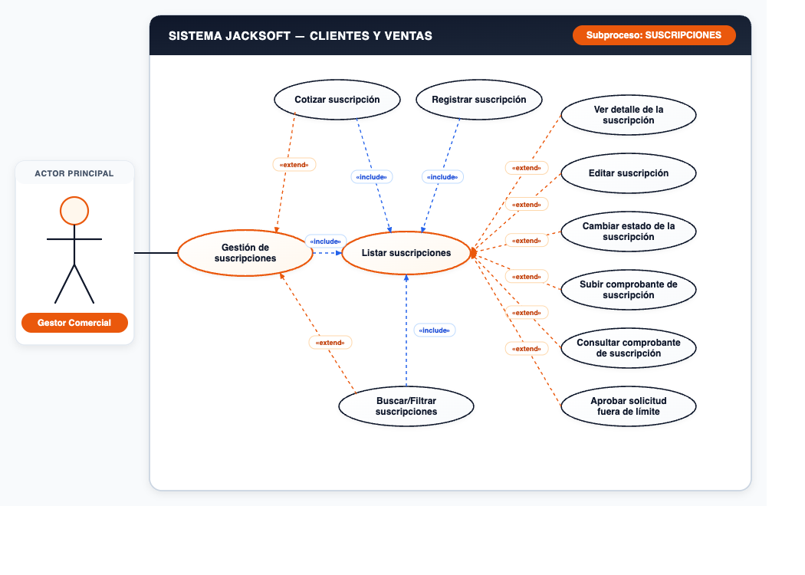
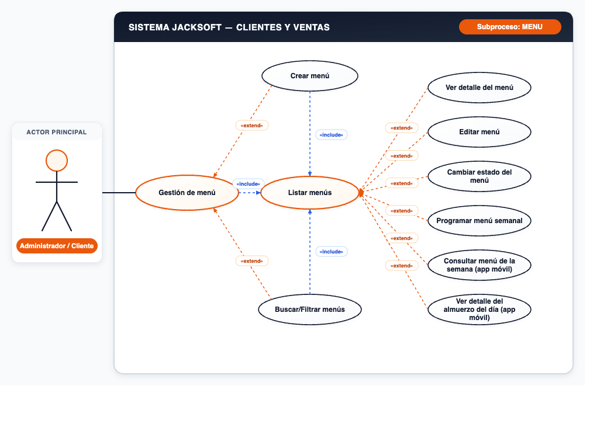

# 📌 CU-05: Módulo de Clientes y Ventas

## 📌 Descripción General
Gestión de clientes, cotización, registro y administración de suscripciones, y programación del menú que reciben los clientes (consultable desde la app móvil).

---

## 📋 Subprocesos y Especificación Funcional

### Subproceso 1: CLIENTES (7 Casos de Uso)
* **Actor Principal:** `Gestor Comercial`
* **Nodo Principal:** `Gestión de clientes`

#### Casos de Uso Oficiales:
1. **Crear cliente**
2. **Listar clientes**
3. **Generar reporte de clientes**
4. **Ver detalle del cliente**
5. **Editar cliente**
6. **Cambiar estado del cliente**
7. **Buscar/Filtrar clientes**

---

### Subproceso 2: SUSCRIPCIONES (10 Casos de Uso)
* **Actor Principal:** `Gestor Comercial`
* **Nodo Principal:** `Gestión de suscripciones`

#### Casos de Uso Oficiales:
1. **Cotizar suscripción**
2. **Registrar suscripción**
3. **Listar suscripciones**
4. **Ver detalle de la suscripción**
5. **Editar suscripción**
6. **Cambiar estado de la suscripción**
7. **Subir comprobante de suscripción**
8. **Consultar comprobante de suscripción**
9. **Buscar/Filtrar suscripciones**
10. **Aprobar solicitud fuera de límite**

---

### Subproceso 3: MENU (9 Casos de Uso)
* **Actor Principal:** `Administrador / Cliente`
* **Nodo Principal:** `Gestión de menú`

#### Casos de Uso Oficiales:
1. **Crear menú**
2. **Listar menús**
3. **Ver detalle del menú**
4. **Editar menú**
5. **Cambiar estado del menú**
6. **Programar menú semanal**
7. **Buscar/Filtrar menús**
8. **Consultar menú de la semana (app móvil)**
9. **Ver detalle del almuerzo del día (app móvil)**

---
