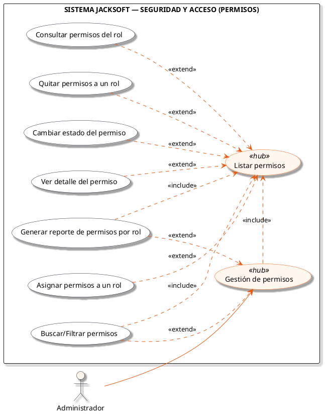
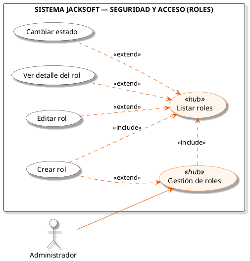
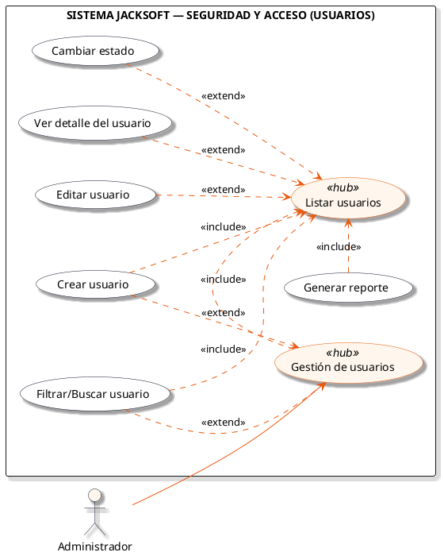
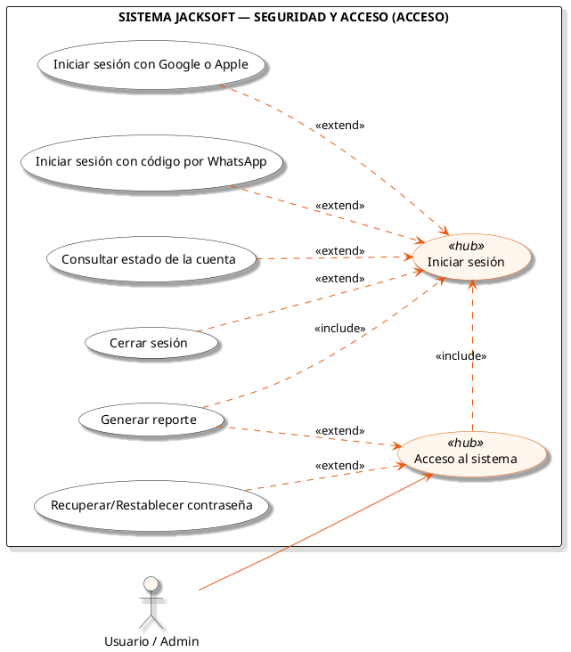
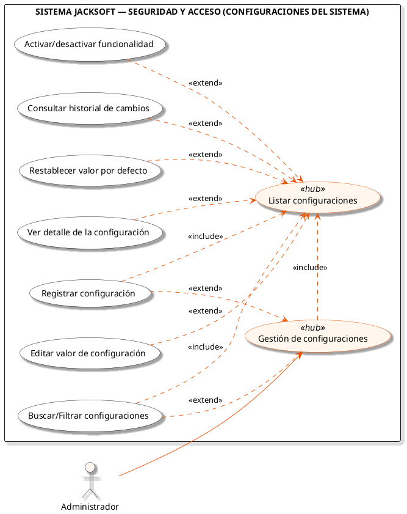

# Macro-Proceso: Configuración y Seguridad

Gestión de permisos (matriz módulo × acción por rol), roles, usuarios, mecanismos de autenticación y acceso al sistema, y configuraciones generales (valores del negocio y funcionalidades activables).

## Subprocesos Integrados

### Subproceso: PERMISOS
- **Total de Casos de Uso / Acciones:** 8
- **Actor Principal:** Administrador
- **Nodo Principal:** Gestión de permisos

#### Listado de Casos de Uso
1. Listar permisos
2. Ver detalle del permiso
3. Asignar permisos a un rol
4. Consultar permisos del rol
5. Quitar permisos a un rol
6. Cambiar estado del permiso
7. Buscar/Filtrar permisos
8. Generar reporte de permisos por rol

#### Diagrama PlantUML

---

### Subproceso: ROLES
- **Total de Casos de Uso / Acciones:** 5
- **Actor Principal:** Administrador
- **Nodo Principal:** Gestión de roles

#### Listado de Casos de Uso
1. Crear rol
2. Listar roles
3. Ver detalle del rol
4. Editar rol
5. Cambiar estado

#### Diagrama PlantUML

---

### Subproceso: USUARIOS
- **Total de Casos de Uso / Acciones:** 7
- **Actor Principal:** Administrador
- **Nodo Principal:** Gestión de usuarios

#### Listado de Casos de Uso
1. Crear usuario
2. Listar usuarios
3. Generar reporte
4. Ver detalle del usuario
5. Editar usuario
6. Cambiar estado
7. Filtrar/Buscar usuario

#### Diagrama PlantUML

---

### Subproceso: ACCESO
- **Total de Casos de Uso / Acciones:** 7
- **Actor Principal:** Usuario / Admin
- **Nodo Principal:** Acceso al sistema

#### Listado de Casos de Uso
1. Iniciar sesión
2. Recuperar/Restablecer contraseña
3. Consultar estado de la cuenta
4. Cerrar sesión
5. Generar reporte
6. Iniciar sesión con Google o Apple
7. Iniciar sesión con código por WhatsApp

#### Diagrama PlantUML

---

### Subproceso: CONFIGURACIONES DEL SISTEMA
- **Total de Casos de Uso / Acciones:** 8
- **Actor Principal:** Administrador
- **Nodo Principal:** Gestión de configuraciones

#### Listado de Casos de Uso
1. Registrar configuración
2. Listar configuraciones
3. Ver detalle de la configuración
4. Editar valor de configuración
5. Activar/desactivar funcionalidad
6. Consultar historial de cambios
7. Restablecer valor por defecto
8. Buscar/Filtrar configuraciones

#### Diagrama PlantUML

---
